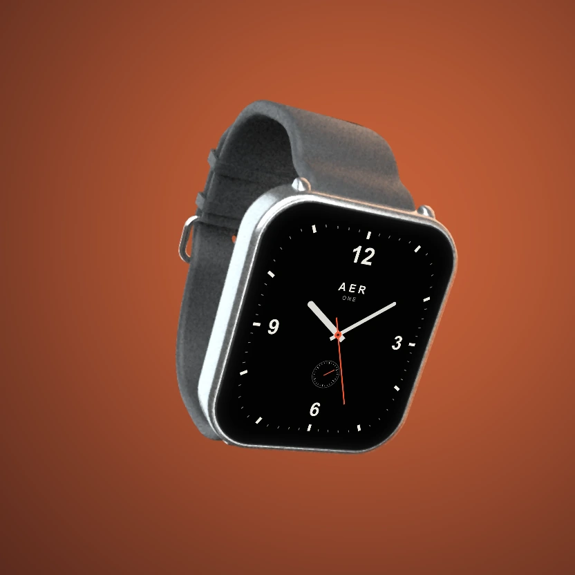
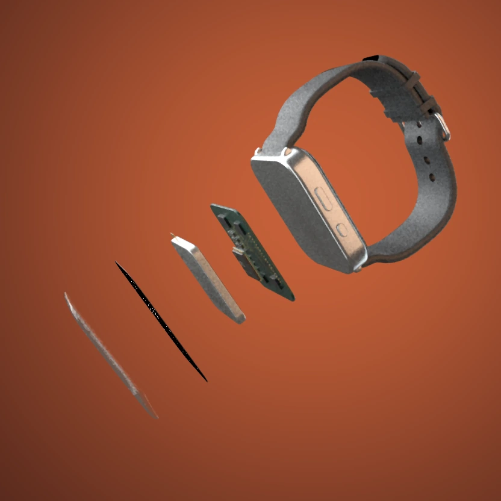

# AER ONE

Интерактивная витрина концепта умных часов. Покрутите часы, рассмотрите отделку и проследите, как при прокрутке корпус раскрывается до платы и чипа.

**[Открыть демо на GitHub Pages](https://ilyaanderson.github.io/aer-one/)** · [Перейти к разборке](https://ilyaanderson.github.io/aer-one/#inside)

<p>
  <a href="https://ilyaanderson.github.io/aer-one/#inside">
    
  </a>
  <a href="https://ilyaanderson.github.io/aer-one/#inside">
    
  </a>
</p>

## Что посмотреть

- **Обзор и материалы.** Часы можно поворачивать мышью, жестом или клавишами со стрелками. Три отделки, отдельные ракурсы корпуса, глянцевого OLED-дисплея и ремешка.
- **На маршруте.** Лесная сцена с параллаксом и тремя режимами дисплея. Часы показывают местное время, а высотомер и компас визуализируют демонстрационный маршрут.
- **Внутри AER ONE.** Покадровый облёт и послойная разборка с подписями, которые следуют за деталями. Для платы, аккумулятора и концептуального чипа A1 подготовлены отдельные 3D-модели.
- **Конфигуратор.** Выбор отделки и размера, демонстрационная корзина с сохранением в браузере. Цена и характеристики иллюстративные.

## Как устроен проект

- React, TypeScript и Vite для интерфейса и статической сборки.
- React Three Fiber, Three.js и glTF для интерактивной модели, с резервным рендером в Canvas 2D.
- Motion связывает анимации с прокруткой. Сцена разборки использует предварительно отрисованные в Mitsuba 3 кадры, которые браузер загружает группами по мере просмотра. При уменьшенном движении доступны статичные кадры всех этапов.
- GitHub Actions собирает и публикует сайт из ветки `main`.

## Локальный запуск

Требуется Node.js 24 и npm.

```sh
npm ci
npm run dev
```

`npm run build` проверяет типы и собирает сайт в `dist/`. `npm run preview` открывает локальный предпросмотр сборки.

## Материалы

- Основа 3D-модели распространяется по CC0. Для проекта подготовлены отделки, циферблат, освещение, внутренние компоненты и рендеры. [Square smartwatch, Innerscene](https://www.innerscene.com/tools/library/3d-parts/square-smartwatch-7b82b808) · [CREDITS.txt](public/models/CREDITS.txt)
- Фотография горной долины использована в сцене «На маршруте». [Unsplash](https://images.unsplash.com/photo-1464822759023-fed622ff2c3b)
- Переменный шрифт с кириллицей поставляется через Fontsource по SIL Open Font License. [Manrope](https://github.com/google/fonts/tree/main/ofl/manrope)
